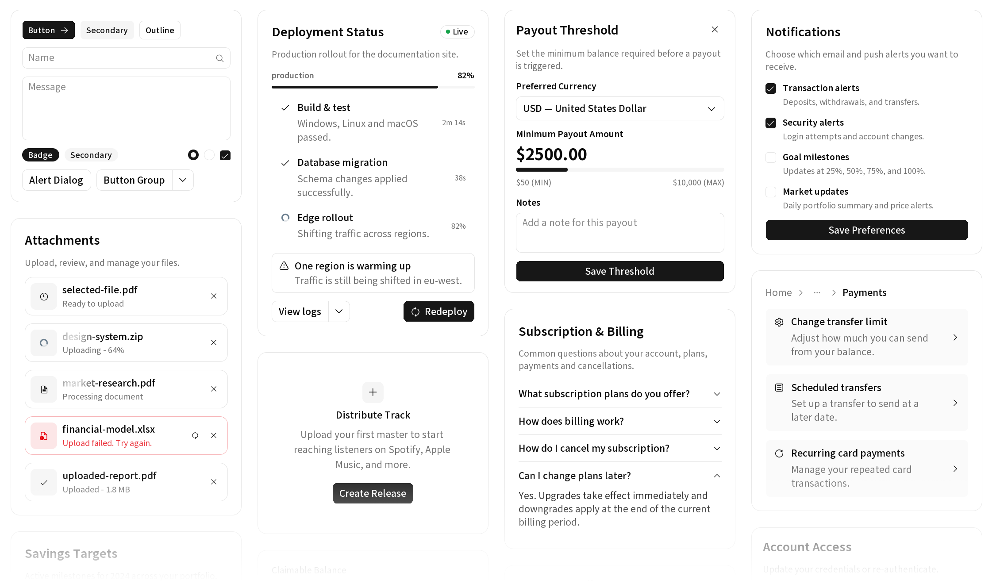

<p align="center">
  <a href="http://lcui.dev/">
    
  </a>
  <h3 align="center">LCUI</h3>
  <p align="center">
    The C library for building user interfaces
  </p>
  <p align="center">
    <a href="README.zh-cn.md">中文</a> / <strong>English</strong>
  </p>
  <p align="center">
    <a href="https://github.com/lc-soft/LCUI/actions"></a>
    <a href="https://codecov.io/gh/lc-soft/LCUI"></a>
    
    
  </p>
  
</p>

## Introduction

LCUI is a library written in C for building graphical user interfaces. Its goal is to explore and practice new ways of developing user interfaces, characterized by its small size, ease of use, and provision of convenient development tools to help developers quickly create desktop applications with graphical user interfaces.

**LC** originates from the initials of the author's name. LCUI began as a way for the author to build small projects and gain development experience. He did not gain an edge in the crowded C/C++ job market, however, and had no choice but to move into web front-end development; as a result, LCUI now leans towards integrating web technologies.

### Key Features

- **Cross-platform:** Windows and Linux.
- **Fully custom-drawn widgets:** consistent appearance and behavior across platforms.
- **Rich built-in widgets:** buttons, inputs, selects, dialogs, alerts, badges, items, and more.
- **CSS layout and styling:** approachable for developers with web experience.
- **DPI awareness:** automatic scaling on high-resolution screens.
- **Modern tooling:** describe UI with TypeScript + JSX + React; `lcui build` generates C source.

> [!WARNING]
> This document targets the next release; some features and design are still in development. Content is for reference only.

## Core concepts

- **Widgets**: the UI is built from widgets; widgets nest to form a widget tree (similar to the web DOM).
- **Events**: input events enter through a window and travel along the widget tree; focus decides where keyboard input goes.
- **Frame loop**: the main loop processes events, updates state, repaints dirty regions, and drives animations and async work.
- **Windows**: a window is a render target that hosts a widget tree and handles size, DPI, and close events.

## Architecture

LCUI is built on top of these libraries:

- [`lib/yutil`](./lib/yutil): common data structures and utilities.
- [`lib/pandagl`](./lib/pandagl): fonts, text layout, image I/O, and rendering.
- [`lib/css`](./lib/css): CSS parser and selector engine.
- [`lib/ptk`](./lib/ptk): cross-platform message loop, windows, timers, and IME.
- [`lib/thread`](./lib/thread): cross-platform threading.
- [`lib/router`](./lib/router): route mapping and navigation.
- [`lib/ui`](./lib/ui): widgets, events, styles, and drawing.
- [`lib/ui-xml`](./lib/ui-xml): create UI from XML.
- [`lib/ui-server`](./lib/ui-server): maps widgets to system windows.

Core source lives in `src/`: `app`, `fonts`, `settings`, `ui`, `widgets`, `worker`.

## Quick Start

### Run Hello World

```shell
git clone https://github.com/lc-soft/LCUI.git
cd LCUI
xmake run hello
```

### Minimal program

```c
#include <LCUI.h>
/* Windows: provides the WinMain → main entry wrapper */
#include <LCUI/main.h>

int main(int argc, char **argv)
{
        ui_widget_t *text;
        lcui_window_t *win;

        /**
         * Build the window options
         * title: window title
         * id: window state id, used to save/restore geometry
         * width/height: default client size on first run
         */
        lcui_window_options_t opt = {
                .title = L"Hello",
                .id = "main",
                .width = 800,
                .height = 600,
        };

        /* initialize LCUI subsystems */
        lcui_init();

        text = ui_create_widget("text");
        ui_text_set_content(text, "Hello, LCUI!");
        /* attach the text to the root widget so the window can render it */
        ui_root_append(text);

        /* Create the window and bind the root widget as its content; it stays hidden */
        win = lcui_window_create_for_widget(ui_root(), &opt);

        /* load the config and restore the saved window geometry */
        lcui_load_settings("dev.example.hello");

        /* Show the window; it becomes visible after the first rendered frame */
        lcui_window_show(win);

        /* run the main loop and clean up on exit */
        return lcui_main();
}
```

### Browse all widgets (optional)

`doc-viewer` showcases all built-in widgets, styles, and interactions. Building it requires Node.js and `@lcui/cli`:

```shell
npm install -g @lcui/cli
cd examples/doc-viewer
npm install
lcui build --skip-xmake
cd ../..
xmake run doc-viewer
```

### Create a new project

`@lcui/cli` is the command-line tool for LCUI. It scaffolds projects, compiles TSX/CSS resources into C source, and works with xmake to build the app.

```shell
npm install -g @lcui/cli
lcui create my-lcui-app
```

Follow the prompts.

#### Manual xmake setup

Without the scaffold, write `xmake.lua` directly:

```lua
add_repositories("lcui-repo https://github.com/lcui-dev/xmake-repo.git")
add_requires("lcui")

target("my-app")
    set_kind("binary")
    add_files("src/*.c")
    add_packages("lcui")
```

Then run:

```shell
xmake run my-app
```

The `lcui` package is self-contained. Do not also depend on the sub-library packages (`pandagl`, `css`, `ptk`, ...) in the same target, or you will get duplicate symbols. If you only need one sub-library, use e.g. `add_requires("pandagl")`.

## Documentation & examples

- [Online documentation](https://lcui-dev.github.io/docs/next/guides/base/)
- [Bundled examples](examples/): `hello`, `todolist`, `fabric`, `doc-viewer`
- Tutorials: [Image viewer](https://lcui-dev.github.io/docs/tutorials/kantu), [Todo list](https://lcui-dev.github.io/docs/tutorials/todolist), [Fabric animation](https://lcui-dev.github.io/docs/tutorials/render-fabric)
- [RFCs](https://lcui-dev.github.io/docs/next/rfcs/) / [Changelog](CHANGELOG.md) / [Contributing](.github/CONTRIBUTING.md)

## Build and test from source

```shell
git clone https://github.com/lc-soft/LCUI.git
cd LCUI
xmake build
xmake test
```

## Contributing

- Improve the docs and examples under `lib/`.
- [Report issues](https://github.com/lc-soft/LCUI/issues) and verify fixes.
- Search for [FIXME](https://github.com/lc-soft/LCUI/search?l=C&q=FIXME) / [TODO](https://github.com/lc-soft/LCUI/search?l=C&q=TODO) comments and fix them.
- Review [pull requests](https://github.com/lc-soft/LCUI/pulls).

This project follows the Contributor Covenant [Code of Conduct](CODE_OF_CONDUCT.md).

## FAQ

### Compilation errors

The build treats warnings as errors. A newer compiler may report more issues. Search all `xmake.lua` files for `set_warnings("all", "error")` and remove that rule.

### Is this a browser engine, or an Electron-like library with an embedded browser?

No. Think of it as a traditional GUI library that borrows some web technologies.

### Why choose LCUI over other GUI libraries?

Consider other GUI libraries first. LCUI currently lacks:

- **Widget coverage is still limited**: common widgets are built in, but complex or specialized controls still need to be built yourself.
- **Fast graphics rendering**: no GPU acceleration; large, complex UIs may stutter.
- **Animation system**: limited visual feedback.
- **Detailed documentation**: existing docs and examples are introductory; deep learning requires reading the source.
- **Frequent updates**: limited by the maintainer's time; requested features or bugs may not be resolved.

Given its current state, LCUI is best for simple tools with minimal UI content and interaction, or the maintainer's personal needs.

### If it uses TypeScript, why not just use Electron?

TypeScript is mainly used to describe UI and resource dependencies; few language features are involved, so you can follow the examples. If you have solid web experience and are willing to learn Electron, Electron is the better choice.

### Please add macOS / Android support

Those ports are expensive to develop and maintain and are not currently planned. If you need them, you can try implementing them, e.g. as separate `lcui-macos` / `lcui-android` projects.

### I want a feature like the one in another project

Open an [issue](https://github.com/lc-soft/LCUI/issues/new/choose) and fill in the template. Describe the need clearly and, if possible, include an implementation idea and references. You can also follow the existing [RFCs](https://lcui-dev.github.io/docs/next/rfcs/).

### Please add Python / Go / Rust / C# / Java bindings

The CLI already compiles TypeScript UI descriptions into C source, which covers most needs, so the author will not add other language bindings. You are welcome to design one yourself.

## License

[MIT](http://opensource.org/licenses/MIT)
