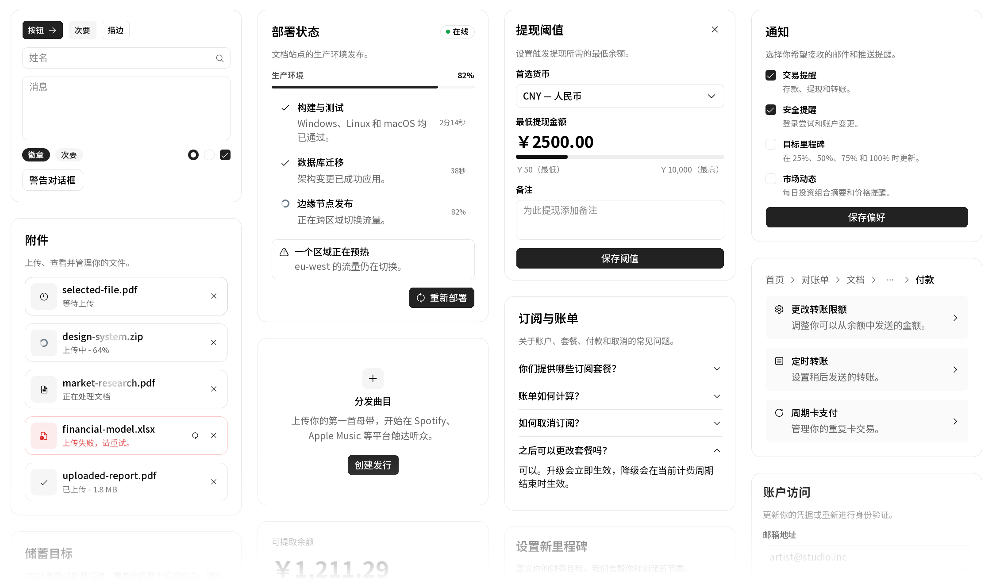

<p align="center">
  <a href="http://lcui.dev/">
    
  </a>
  <h3 align="center">LCUI</h3>
  <p align="center">
    用于开发图形用户界面的 C 库
  </p>
  <p align="center">
    <strong>中文</strong> / <a href="README.md">English</a>
  </p>
  <p align="center">
    <a href="https://github.com/lc-soft/LCUI/actions"></a>
    <a href="https://codecov.io/gh/lc-soft/LCUI"></a>
    
    
  </p>
  
</p>

## 介绍

LCUI 是一个用 C 语言编写的用于构建图形用户界面的库。它的定位是探索和实践新的用户界面开发方式，以体积小、易于使用、提供便捷的开发工具为特点，帮助开发者快速开发带有图形用户界面的桌面端应用程序。

**LC** 源自作者名字首字母。LCUI 最初是为了方便作者开发小项目、积累开发经验；但作者并没有因此在 C/C++ 高手众多的就业环境中获得优势，无奈之下转而从事 Web 前端开发。也正因如此，LCUI 如今的发展方向更偏向融合 Web 前端领域的技术。

### 主要特性

- **跨平台**：支持 Windows 与 Linux。
- **全自绘组件**：组件在各平台外观与行为一致。
- **丰富的预置组件**：按钮、输入框、选择器、对话框、提示、徽章、列表项等。
- **CSS 布局与样式**：有 Web 开发经验可以快速上手。
- **DPI 感知**：高分辨率屏幕下自动缩放。
- **现代化工具链**：可用 TypeScript + JSX + React 描述界面，由 `lcui build` 生成 C 源码。

> [!WARNING]
> 本文档面向下个版本，部分功能和设计仍在开发中，内容仅供参考。

## 核心概念

- **部件（widget）**：界面由部件组成；部件可以嵌套，形成一棵部件树（类似 Web 的 DOM 树）。
- **事件**：输入事件从窗口进入，沿部件树传递；焦点决定键盘输入的去向。
- **帧循环**：主循环处理事件、更新状态、重绘脏区，并驱动动画与异步任务。
- **窗口**：窗口是渲染目标，承载一棵部件树，并处理尺寸、DPI 与关闭等系统交互。

## 架构

LCUI 建立在以下库之上：

- [`lib/yutil`](./lib/yutil)：通用数据结构与工具。
- [`lib/pandagl`](./lib/pandagl)：字体、文字排版、图片读写与渲染。
- [`lib/css`](./lib/css)：CSS 解析与选择器。
- [`lib/ptk`](./lib/ptk)：跨平台消息循环、窗口、定时器与输入法。
- [`lib/thread`](./lib/thread)：跨平台多线程。
- [`lib/router`](./lib/router)：路由与导航。
- [`lib/ui`](./lib/ui)：组件、事件、样式与绘制。
- [`lib/ui-xml`](./lib/ui-xml)：从 XML 创建界面。
- [`lib/ui-server`](./lib/ui-server)：把组件映射到系统窗口。

核心源码位于 `src/`：`app`、`fonts`、`settings`、`ui`、`widgets`、`worker`。

## 快速开始

### 运行 Hello World

```shell
git clone https://github.com/lc-soft/LCUI.git
cd LCUI
xmake run hello
```

### 最小程序

```c
#include <LCUI.h>
/* Windows 下提供 WinMain → main 的入口包装 */
#include <LCUI/main.h>

int main(int argc, char **argv)
{
        ui_widget_t *text;
        lcui_window_t *win;

        /**
         * 构造窗口配置项
         * title: 窗口标题
         * id: 窗口状态标识，用于保存/恢复位置与尺寸
         * width/height: 首次运行时的默认客户区尺寸
         */
        lcui_window_options_t opt = {
                .title = L"Hello",
                .id = "main",
                .width = 800,
                .height = 600,
        };

        /* 初始化 LCUI 子系统 */
        lcui_init();

        text = ui_create_widget("text");
        ui_text_set_content(text, "Hello, LCUI!");
        /* 把文本挂到根部件，窗口以根部件为内容时才能渲染它 */
        ui_root_append(text);

        /* 创建窗口并绑定根部件作为内容，此时窗口保持隐藏 */
        win = lcui_window_create_for_widget(ui_root(), &opt);

        /* 加载配置，恢复上次保存的窗口位置与尺寸 */
        lcui_load_settings("dev.example.hello");

        /* 显示窗口，窗口将在首帧渲染后显示 */
        lcui_window_show(win);

        /* 进入主循环，退出时清理 */
        return lcui_main();
}
```

### 浏览全部组件（可选）

`doc-viewer` 展示了全部预置组件、样式和交互效果。构建它需要 Node.js 和 `@lcui/cli`：

```shell
npm install -g @lcui/cli
cd examples/doc-viewer
npm install
lcui build --skip-xmake
cd ../..
xmake run doc-viewer
```

### 创建新项目

`@lcui/cli` 是 LCUI 的命令行开发工具：负责创建项目骨架、把 TSX/CSS 等资源编译为 C 源码，并配合 xmake 构建应用。

```shell
npm install -g @lcui/cli
lcui create my-lcui-app
```

按命令提示选择模板。

#### 手动配置 xmake

不使用脚手架时，可以直接编写 `xmake.lua`：

```lua
add_repositories("lcui-repo https://github.com/lcui-dev/xmake-repo.git")
add_requires("lcui")

target("my-app")
    set_kind("binary")
    add_files("src/*.c")
    add_packages("lcui")
```

然后运行：

```shell
xmake run my-app
```

`lcui` 包是自包含的，不要在同一 target 里再依赖 `pandagl`、`css`、`ptk` 等子库包，否则会出现重复符号。只使用单个子库时，可以改为 `add_requires("pandagl")`。

## 文档与示例

- [在线文档](https://lcui-dev.github.io/docs/next/guides/base/)
- [内置示例](examples/)：`hello`、`todolist`、`fabric`、`doc-viewer`
- 教程：[图像查看器](https://lcui-dev.github.io/docs/tutorials/kantu)、[待办清单](https://lcui-dev.github.io/docs/tutorials/todolist)、[渲染布料动画](https://lcui-dev.github.io/docs/tutorials/render-fabric)
- [意见征集稿（RFC）](https://lcui-dev.github.io/docs/next/rfcs/) / [更新日志](https://github.com/lc-soft/LCUI/releases) / [贡献指南](.github/CONTRIBUTING.md)

## 从源码构建与测试

```shell
git clone https://github.com/lc-soft/LCUI.git
cd LCUI
xmake build
xmake test
```

## 贡献

- 完善 `lib/` 下各库的文档与示例。
- [反馈问题](https://github.com/lc-soft/LCUI/issues)，并在修复后帮助验证。
- 搜索并解决源码中的 [FIXME](https://github.com/lc-soft/LCUI/search?l=C&q=FIXME) / [TODO](https://github.com/lc-soft/LCUI/search?l=C&q=TODO)。
- 审查[代码改动](https://github.com/lc-soft/LCUI/pulls)。

本项目采用参与者公约定义的[行为准则](CODE_OF_CONDUCT.zh-cn.md)。

## 常见问题

### 编译报错了

本项目的构建配置加入了“将警告视为错误”编译选项，可能是因为你的编译器比较新，能够从代码中发现更多问题。你可以搜索所有包含 `set_warnings("all", "error")` 的 `xmake.lua` 文件，然后删除这项规则。

### 这是一个浏览器内核吗？或者像 Electron 那样集成了浏览器环境？

不是。可以把它当成一个应用了部分 Web 技术的传统 GUI 开发库。

### 相比其它 GUI 库/框架，为什么选择 LCUI？

建议优先考虑其它 GUI 库/框架，因为 LCUI 目前缺少：

- **组件覆盖仍有限**：已内置常用组件，但复杂或专业控件仍需自行实现。
- **高效的图形渲染性能**：没有 GPU 加速，界面内容较多且较大时可能卡顿。
- **动画系统**：界面缺少动效反馈，影响交互体验。
- **详尽且友好的文档**：现有文档和示例仅供简单了解，深入学习需要阅读源码。
- **积极的更新**：受限于维护者的个人兴趣和时间，更新频率很低，提交的需求或 BUG 不一定会被解决。

以 LCUI 现有的条件，除了满足维护者的个人需求外，只适用于开发一些界面内容和交互都很简单的小工具。

### 都用上 TypeScript 了，为什么不直接用 Electron？

目前 TypeScript 主要用于描述界面和资源依赖，用到的语言特性较少，不需要深入学习，大多数情况下参考示例代码即可。

如果你有较丰富的 Web 开发经验且愿意学习 Electron，显然 Electron 更合适。

### 建议添加 macOS、Android 支持

这些特性的开发和维护成本较高，暂无相关计划。如果迫切需要，可以尝试自行实现，例如新建 `lcui-macos`、`lcui-android` 项目。

### 我想要某个功能，就像某个项目里的那样

请先[新建 issue](https://github.com/lc-soft/LCUI/issues/new/choose)，按模板补全内容，并尽量提供开发思路和参考资料。也可以参考现有的[意见征集稿（RFC）](https://lcui-dev.github.io/docs/next/rfcs/)来撰写。

### 求添加 Python / Go / Rust / C# / Java 语言绑定

LCUI 的命令行工具已经支持将 TypeScript 写的界面配置编译为 C 源文件，虽然不是语言绑定但也够用，因此作者不会再添加其它语言绑定。如果你确实需要，可以自行设计实现。

## 许可

[MIT](http://opensource.org/licenses/MIT)
